# 사이트 갱신 — 2.2.0

2.2.0 앱(방송 연동, 간편 설정, 노드 편집기, 던지기·액체·쓰러짐, DLC 방 팩, 새 패널)에 맞춰 가이드와 홈페이지를 고쳤고, 사이트 UI를 Apple 디자인 지침으로 점검해 고쳤다. 기준은 앱 저장소 `89aa2506`(2.2.0 기능 병합)과 `docs/stages/changes-2.2.0.md`. 업데이트 페이지의 2.2.0 항목은 넣지 않았다(오케스트레이터가 패치 노트와 함께 넣는다). main에 올리거나 배포하지 않았다.

## 감사: 가이드 장마다

| 장 | 2.2.0 기준 상태 | 한 일 |
|---|---|---|
| 01 시작하기 | 방송 연동 안내 없음 | "시청자 이벤트에 아바타가 반응" 행 추가 |
| 02 Avatar Exporter | 바뀐 것 없음 | 없음 |
| 03 아바타 라이브러리 | 글은 맞음. 사진의 라이브러리 창에 Windows 사용자 이름이 든 경로가 보였음(현재 공개 사이트도 같음) | 새 사진에서 경로를 흐림 |
| 04 메인 화면 | 왼쪽 메뉴 표에 **방송** 없음, 합방이 출력에 있다고 적힘 | 방송 행 추가, 출력·스튜디오 설명 수정 |
| 05 아바타 메뉴 | 바뀐 것 없음 | 사진만 새로 |
| 06 장치 | 바뀐 것 없음 | 사진만 새로 |
| 07 동작 | "시선 대상" → 앱 이름 **바라보기 대상** | 이름 수정, 사진 새로 |
| 08 스튜디오 | 배경 카드의 "촬영 화면"이 사진 및 녹화 탭으로 옮겨짐, 로우폴리 건물 전체 선택 삭제, DLC 방 안내 없음 | 촬영 화면 문단을 옮긴 곳 안내로, DLC 방 장 링크, 로우폴리 변경 알림 |
| 08 카메라 효과 | 바뀐 것 없음 | 사진만 새로 |
| 09 출력 | 사진·녹화가 스튜디오 › **사진 및 녹화** 탭으로, 합방이 방송 › 연결로 옮겨짐. 녹화 소리(마이크 + 공유 게임 소리) 설명 없음 | 위치·녹화 소리 수정, 사진 촬영 계획을 새 탭으로 |
| 09 원격 합방 | "출력 → 송출 → 세션"은 없는 경로. 동의 4개 → 스위치 1개(데이터 주고받기) + 개별 설정 | 경로·동의 설명 수정, 사진 촬영 계획을 방송 › 연결로 |
| 10 설정 | 라이선스 칸이 "다른 코드 입력" 하나로 합쳐짐(업그레이드·DLC 포함), 오류 보고에 방송 연결 정보, 정보 카드(공식 디스코드) | 라이선스·진단 문단 수정, **정보** 절 추가 |
| 11 포징과 표정 | 바뀐 것 없음 | 사진만 새로 |
| 12 문제 해결 | 방송 연동 문제 해결·진단 데이터 없음, 합방 위치 옛것 | **방송 연동이 안 될 때** 절(확인 순서, 보고서에 들어가는 것, 가려지는 것) 추가 |
| 13 에디션과 라이선스 | 에디션 표에 방송 연동·노드 편집기·방·DLC 없음, 업그레이드 입력 위치 옛것 | 표 4행 추가, 코드 입력·DLC 활성화 문단 수정 |
| 업데이트 | 2.2.0 항목 없음 | 지시대로 손대지 않음 |
| 약관·개인정보 | 방송 연동이 새로 쓰는 서버(`stream-auth.erp.pictures`, `discord-check.erp.pictures`), 시청자 그림 받기, DLC 받기가 개인정보 처리방침에 있는지 확인 안 함 | **사용자 검토 필요**(법적 문서라 고치지 않음) |

## 새 가이드 장 (4개 언어, 같은 구조)

| 파일 | 제목(ko) | 내용 |
|---|---|---|
| `09-broadcast.md` | 방송 연동 | 방송 페이지 두 탭, Twitch·치지직·SOOP 연결과 받는 이벤트, 디스코드(앱 추가 링크, 서버·계정 추가 차이, 코드로 채널 연결, `/패널`·`/반응`, 명령 표, 포인트 게임), 웹소켓, Basic/Pro 표, 개발자 서버 안내 |
| `09-interactions.md` | 간편 설정 | 목록 행의 뜻, 단계(플랫폼 → 연결 → 던지기·스티커·액체), 예시 표(팔로우 → 던지기, 후원 N원 이상 → 액체 등), 트리거·동작·쿨다운, 테스트 |
| `09-reactions.md` | 던지기 · 액체 · 쓰러짐 | 던지기·액체·스티커·조명 설정, 쓰러짐과 일어나기 3값, 후원 표시, 테스트 카드 버튼 |
| `09-node-editor.md` | 노드 편집기 | 간편 설정과의 차이, 창 열기와 각 자리, 노드·흐름/값 연결, 예시 그래프(치지직 후원 → 정수 A ≥ B → 조건 분기 → 액체 뿌리기), 간편 설정 항목을 고치면 생기는 일, 가져오기·내보내기, Basic은 보기만 |
| `08-rooms.md` | DLC 방 팩 | BOOTH 구매 → 다른 코드 입력에 주문번호, 방 목록에서 받기·지우기·업데이트, 방을 고르면 바뀌는 환경, 방 불빛 스위치·밝기·구역, 벽 숨기기, 한 PC·이동 1회 |

용어: "간편 설정"(마법사·wizard 없음), "쓰러짐"(래그돌 없음), "미지원" 없음. 방송 기능은 모두 "베타"로 적었다(changes-2.2.0의 사용자 결정).

## 홈페이지 (`content/<lang>/home.json`, `build.py`, `assets/site.css`, `assets/site.js`)

- **키 비주얼**: 사용자가 준 사진(밤 골목 DLC 방의 여우 아바타, `.local/keyvisual/alley-fox-user.webp` → `shots/common/keyvisual.png`)을 세 곳에 썼다.
  - 첫 화면(히어로): 데스크톱은 사진을 화면 폭의 120%로 깔아 아바타가 오른쪽(화면 폭 53~74%)에 서고, 글은 왼쪽 어두운 골목 위(화면 폭 50% 안)에 놓인다. 글 뒤만 어둡게 한다(왼쪽 0.9 → 42% 지점 0.84 → 54% 지점 0). 폰은 사진을 정사각형으로 잘라 아바타 전신을 위에, 글은 그 아래에 둔다. 글은 어느 폭에서도 아바타와 겹치지 않는다(900·1024·1440·1920px에서 확인).
  - 둘러보기의 **DLC 방 팩** 줄: `video:rooms|common:keyvisual`(VID1의 rooms 영상이 오면 영상, 그전엔 이 사진).
  - 공유 이미지 `assets/brand/og-<lang>.jpg`(`make_og.py`): 사진에서 1500×787 구간을 잘라 아바타를 오른쪽(1200폭의 700~990)에, 제목을 왼쪽 어두운 쪽에 둔다.
  - 기존 히어로 영상(Main)은 키 비주얼 아래 그대로 있다.
- **다른 사람 아바타·외부 영상 제거**: 홈페이지 영상 중 `face`(얼굴부터 전신까지)와 `menu`(Expression 메뉴)는 확인되지 않은 아바타(lilToon_Airi), `share`(방송과 화면 공유)는 다른 회사 게임 화면이었다. 세 영상과 포스터를 지우고 Main으로 찍은 새 사진(`guide-face-calibration`, `guide-avatar-menu`, `guide-main`)으로 바꿨다. 쓰지 않던 `light` 영상도 지웠다.
- **쓰지 않는 옛 사진 378개 삭제**: `docs/assets/shots`에는 옛 빌드의 사진(v45-*, menu, avatar-pop 등)이 페이지에서 쓰이지 않은 채 계속 남아 배포되고 있었다(일부는 다른 아바타). 어느 페이지도 참조하지 않는 사진을 모두 지웠다(지금은 참조 479개, 미참조 0개).
- **방송 연동 · 베타** 절 신설(둘러보기 다음): 간편 설정 · 던지기·액체·쓰러짐 · 디스코드 친구의 반응 · 노드 편집기 카드 4개와, 디스코드 앱 추가 버튼(`https://discord.com/oauth2/authorize?client_id=1563157504995754014`) + 연결 방법 링크. 카드 영상은 VID1이 이 브랜치에 올린 `broadcast`·`reactions`·`nodes`(커밋 `2570e5b`)를 쓴다.
- 둘러보기에 **DLC 방 팩** 줄, 에디션에 Basic "DLC 방 팩 (별도 구매)"·Pro "방송 연동 · 노드 편집기 (베타)", FAQ 답 수정과 새 질문 3개.
- 영상 자리: `video:<이름>|img:<사진>` 꼴. `assets/video/<이름>.mp4`가 있으면 영상, 없으면 사진(`build.py media()`). `rooms`, `trailer`는 아직 없다.

## 디자인 감사 (Apple HIG)

참고: `apple-design` 스킬의 `accessibility.md`, `layout.md`, `typography.md`, `color.md`, `dark-mode.md`, `buttons.md`, `sidebars.md`, `motion.md`, `branding.md`, `designing-for-macos.md`, `cross-platform.md`(웹은 Electron/웹 용어로 옮김). 웹사이트라 플랫폼 관례(메뉴 막대·탭 막대) 대신 원칙과 기초(접근성·색·글자·배치·글)를 적용했다. 색 팔레트와 로고는 그대로다.

**요약**: 고치기 전 평가는 "Critical issues"(작은 글자의 대비 부족, 숨은 목차의 키보드 접근, 멈출 수 없는 자동 재생 영상). 고친 뒤에는 Critical 없음. 이 디자인이 기억될 한 가지는 이제 키 비주얼(밤 골목의 여우)이고, 나머지는 조용하게 두었다.

| 심각도 | 무엇 | 근거 | 고친 것 |
|---|---|---|---|
| Critical | 보조 글자색 `--text-3`(메타·캡션·푸터·목차, 13~14px)이 다크 4.03:1(배경)·3.76:1(카드), 라이트 3.26:1·3.40:1 | `accessibility.md › Vision` "Up to 17 pts … 4.5:1" | 다크 `#70707e → #8a8a97`(5.77 / 5.38 / 카드2 5.07:1), 라이트 `#8a8a98 → #6b6b79`(5.03 / 5.24 / 4.74:1). 색이 아닌 회색 밝기만 바뀜 |
| Critical | 폰의 가이드 목차 서랍이 닫혀도 화면 밖에서 Tab으로 들어가짐, Esc로 닫으면 버튼이 열림 상태로 남음 | `accessibility.md › Speech` "Let people use the keyboard alone…" | 닫힌 서랍은 `visibility: hidden`, Esc가 서랍·모바일 메뉴·언어 메뉴를 닫고 포커스를 연 버튼으로 돌림 |
| Critical | 자동 재생 영상(히어로·카드)에 멈춤 수단 없음(동작 줄이기 켜면 재생 안 함은 이미 됨) | `accessibility.md › Cognitive` "Avoid autoplaying audio and video content without also providing controls to start and stop it" | 영상마다 오른쪽 아래 일시정지/재생 버튼(36px, 4개 언어 라벨), 멈춘 영상은 스크롤해도 다시 재생 안 함 |
| High | 사이트 자체 테마 스위치, 기본은 늘 다크(시스템 설정 무시) | `dark-mode.md › Best practices` "Avoid offering an app-specific appearance setting" | 스위치 제거, 시스템의 라이트/다크를 따름(`prefers-color-scheme`), `theme-color`도 둘. 키 비주얼 띠는 두 모드 모두 어둡게 유지 |
| High | 한 화면에 채운 보라 버튼 두 개(헤더 "구매하기" + 히어로 "시작하기") | `buttons.md › Style` "use a button that has a prominent visual style for the most likely action in a view" | 헤더 구매 버튼은 옅은 틴트 스타일, 화면의 주 버튼만 채운 보라. 에디션은 Pro만 채움, 디스코드 줄은 추가 버튼만 채움 |
| Medium | 눌러지지 않는 카드가 마우스를 올리면 떠오르고 사진이 확대됨 | `motion.md › Best practices` "Add motion purposefully"; 반응은 누를 수 있는 것에만 | 카드 호버 이동·확대 제거. 버튼에는 누름 상태(`:active`) 추가(`buttons.md › Best practices` "Always include a press state") |
| Medium | 간격 값이 제각각(6·7·9·10·11·14·18·22·26·30px…) | `layout.md › Visual hierarchy` 정렬·묶음; 4/8 격자는 판단 | margin·padding·gap을 4px 격자로(동률은 8의 배수), 글자 크기와 합쳐 83곳 |
| Medium | 글자 크기 단계가 너무 많음(12.5·13.5·14.5·18.5px 반 픽셀) | `typography.md` "Minimize the number of typefaces…", 위계는 크기·굵기로 | 반 픽셀을 13·14·15·18px로 합침. 본문 16px, 최소 13px |
| Medium | 폰 헤더 아이콘·언어 버튼 38px, 목차 줄 약 35px | `accessibility.md › Mobility` iOS 기본 44×44 | 폰에서 44px |
| Medium | 동작 줄이기·투명도 줄이기·대비 높이기에 대한 답이 일부만 | `accessibility.md › Cognitive`, `color.md` "work well in light, dark, and increased contrast" | 동작 줄이기: 모든 전환 끔. 투명도 줄이기: 헤더·영상 버튼의 흐림을 불투명으로. 대비 높이기: 보조 글자·선 진하게(다크·라이트) |
| Low | "이런 곳에서 바로"(OBS·Discord…)가 테두리 알약이라 버튼처럼 보임 | `branding.md` "Express your brand with familiar components" | 점으로 나눈 글 목록으로 |
| Low | 히어로 영상 위 가짜 창 막대(맥 신호등 점) — Windows 앱인데 맥 창 모양, 장식뿐 | `branding.md` "Ensure branding always defers to content", 덜어낼 장식 하나 | 창 막대와 뒤 보라 번짐 제거, 영상 테두리만 |

**그대로 둔 것(잘 된 점)**: 팔레트(다크 `#0b0b0f`·보라 `#8b7cf6`, 라이트 `#fafafb`·`#6b5ce7`)와 로고, 본문 대비(다크 7.4~16.8:1, 라이트 6.5~18.8:1), `:focus-visible` 2px 테두리, 본문 건너뛰기 링크, 가이드의 2단 사이드바(두 단계까지)와 현재 위치 표시, 오른쪽 "이 페이지" 목차(1180px 이하에서 숨김), 폰의 표 → 카드 변환. 주 버튼의 흰 글자/보라 배경은 다크 3.33:1로 굵은 글자 기준 3:1을 넘는다(`accessibility.md › Vision` "All / Bold / 3:1").

**히어로 글 대비(사진 위, 가장 밝은 픽셀 기준)**: 1440px에서 제목 흰 줄 14.1:1, 보라 줄 5.0:1, 설명 9.7:1, 메타 7.4:1. 1920px에서 보라 줄이 3.4:1(56px 굵은 글자라 3:1 기준 통과).

### 전후 사진 (`reports/site-refresh-2.2.0/`)

| 화면 | 전 | 후 |
|---|---|---|
| 홈 첫 화면 1440px | 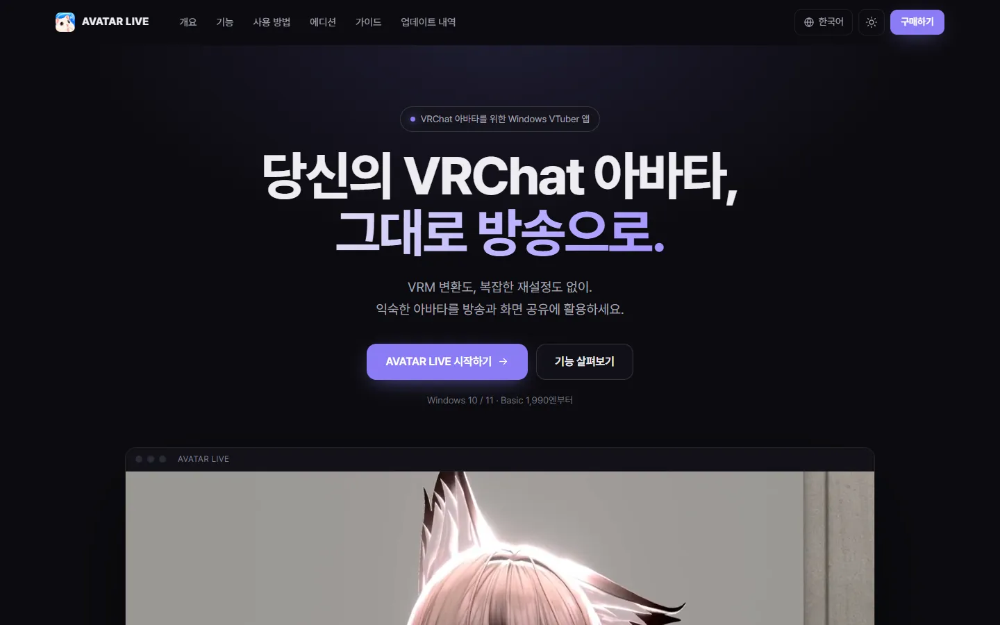 | 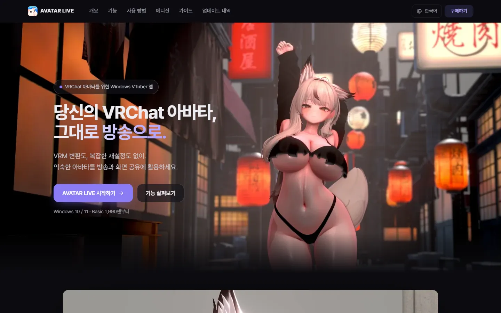 |
| 홈 첫 화면 1440px, 라이트 | — (전에는 스위치로만) | 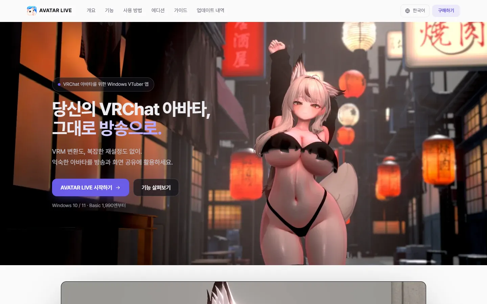 |
| 홈 첫 화면 390px | 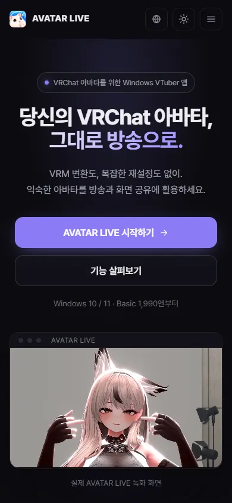 | 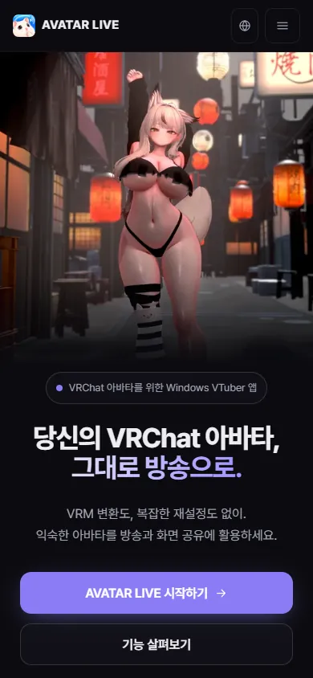 |
| 원격 합방 1440px(절반 크기) | 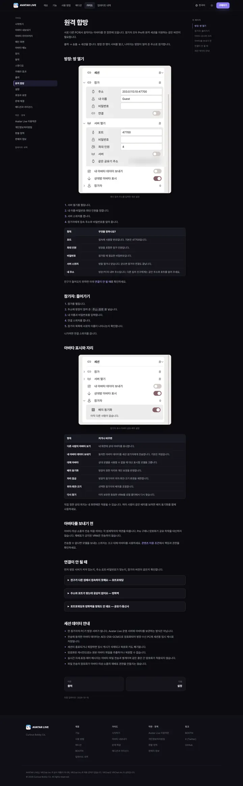 | 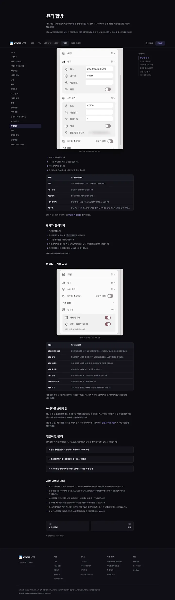 |
| 원격 합방 390px | 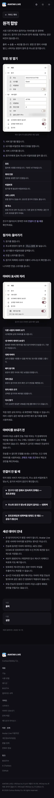 | 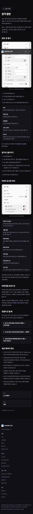 |
| 방송 연동(새 장) 1440px / 390px | — | 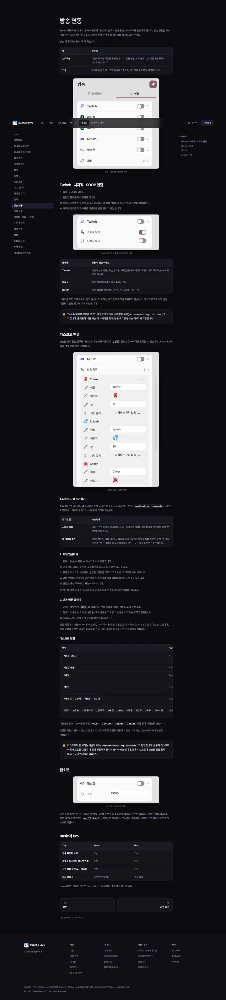 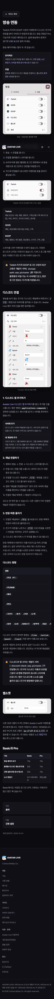 |
| 노드 편집기(새 장) 1440px / 390px | — | 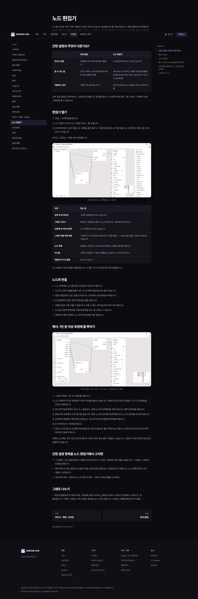 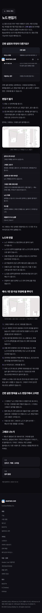 |

"전" 원격 합방 사진에는 공개 중인 사이트 그대로 이 PC의 내부 IP가 보여 보고서 사진에서는 흐렸다.

## 사진

- 앱: `89aa2506`에서 만든 개발 플레이어(`.local/player`). 모든 실행은 `nofocus.launch()`를 거쳤다. 클릭이 필요한 사진(간편 설정 단계, 노드 편집기)은 창을 화면 밖에 비활성으로 띄우고 클릭 메시지를 보냈다.
- 모습: 사용자의 현재 스튜디오 **Main 3**(`studio-fb96c3efe0d9`, 회색 0.48, 화면 조명 끔)을 `.local/capture/<lang>`에 복사만 해서 썼다(원본은 건드리지 않음). 배경 그림 경로와 방은 비우고, 노출은 앱 기본값, 아바타 조명은 프리셋 **기본**(스포트라이트; 아바타 프로필의 저장 조명을 뺐다). DLC 방을 연 사진과 반응 장면 사진은 찍지 않았다.
- 아바타: 허용된 4개(Main `av-2f53db2d8cbf6641`, Loop Neko, 아이리 Straight Flush, Kaguya_Mayo_뉴)만 라이브러리·최근 목록에 남겼고, 장면 속 아바타는 모두 Main이다. 다른 아바타로 찍힌 이전 사진(`.local/shots-run4`)은 지웠고 커밋하지 않았다.
- 방송 설정은 비우고 예시만 넣었다: 간편 설정 예시 4개(로그인·채널·시청자 없음), 손으로 배치한 예시 그래프 1개(꺼진 상태). 플랫폼·디스코드 스위치는 켜지 않았다.
- 가린 것·뺀 것: 라이브러리 창의 아바타 경로(Windows 사용자 이름) 흐림, 세션 카드의 "같은 공유기 주소"(내부 IP) 흐림, 화면 공유 설정(이 PC의 게임·창 목록 — 처음 찍은 사진에 "Cyberpunk2077"이 보여 설정에서 빼고 다시 찍음).
- 촬영 도구: `tools/capture_localized_guides.py`(nofocus 실행, 재시도·이어 찍기, 허용 아바타, Main 3 복사, 기본 조명, 예시 규칙·그래프, 클릭 사진, 흐림, 공유 기록 제외), `tools/capture_guide.py`(한 사진이 실패해도 나머지를 찍고 끝에 실패, 행 흐림), `tools/guide_capture_plan.json`(새 위치, 방송 사진, 조명 사진은 기본 프리셋의 `spot-light-face`).

### 다시 찍은 사진 (ko·en·ja·zh 각 91장, 모두 위 조건)

guide-auto-expression, guide-avatar-library, guide-avatar-menu, guide-background, guide-broadcast-connect, guide-camera-aim, guide-camera-multiview, guide-camera-position, guide-camera-toolbar, guide-default-pose, guide-devices, guide-discord, guide-donation, guide-effects, guide-face-adjust, guide-face-calibration, guide-fall, guide-fx-bloom, guide-fx-blur, guide-fx-chromatic, guide-fx-color, guide-fx-dirt, guide-fx-dof, guide-fx-flares, guide-fx-hbao, guide-fx-night, guide-fx-pixelate, guide-fx-sharpen, guide-fx-vignette, guide-gestures, guide-hotkeys, guide-interaction-test, guide-interactions, guide-launcher, guide-launcher-start, guide-light-detail, guide-lighting, guide-main, guide-menu-context, guide-menu-poses, guide-motion-afk, guide-motion-body, guide-motion-eyes, guide-motion-face, guide-motion-hands, guide-motion-mouth, guide-my-expression, guide-ndi, guide-node-editor, guide-node-editor-lists, guide-output-image, guide-phone, guide-photo-record, guide-pose-library, guide-pose-tracking, guide-posing, guide-post-aa, guide-post-bloom, guide-post-chromatic, guide-post-color, guide-post-dof, guide-post-grain, guide-post-motion, guide-post-vignette, guide-props, guide-room, guide-rule-light, guide-rule-liquid, guide-rule-throw, guide-rule-trigger, guide-scenes, guide-session, guide-session-options, guide-settings-about, guide-settings-diagnostics, guide-settings-performance, guide-settings-ui, guide-settings-updates, guide-settings-window, guide-share, guide-simple-setup, guide-simple-setup-connect, guide-spout, guide-steamvr, guide-studio-avatar, guide-studio-camera, guide-tracking-sources, guide-twitch, guide-virtual-camera, guide-vmc, guide-websocket.

카메라 효과 예시 사진(`guide-example-*-on/off`)과 조명 프리셋 모음(`common/light-*`)은 Main으로 찍힌 기존 것을 그대로 썼다.

## 검사

- `uv run --no-project --with markdown --with pillow python build.py`: 104페이지, 이미지 410개.
- `check_links.py` ko·en·ja·zh: 각 0건. `check_site_images.py`: 0건. `check_guide_parity.py`: 불일치 0건. `tools/verify_site.cjs`(Edge, 104페이지 × 3폭): 312검사 실패 0건.
- 페이지가 참조하지 않는 사진·영상 0개.
- 눈으로 본 것: 홈(1440·390px, 다크·라이트), 원격 합방·방송 연동·노드 편집기(1440·390px), 히어로 900·1024·1440·1920px. 폰 홈 전체 캡처는 높이가 16384px를 넘어 Chromium 캡처에서 아래쪽이 반복되어 보이는데, 페이지에는 히어로가 하나뿐이다(캡처 한계).

## 검증하지 않은 것 · 하지 않은 것

- **디스코드 쪽 화면**(앱 추가 화면, `/연결`, 버튼 패널, 친구 메시지): 시험 계정이 없고 실제 서버에 글을 남기게 되므로 찍지 않았다. 가이드는 글로만 설명한다.
- 실제 Twitch·치지직·SOOP·디스코드 이벤트로 동작하는지(앱 문서에도 확인 기록 없음 → 베타 표기).
- Basic + DLC 실기, Basic에서 방송 페이지가 잠긴 모습(사진은 Pro 상태).
- **반응 장면 사진**(던지기·액체·쓰러짐을 맞은 아바타): 시험 중 던진 물건이 Main 아바타의 옷을 밀어내 노출에 가까운 모습이 나와 찍지 않았다. 홈페이지는 VID1의 `reactions` 영상을 쓴다.
- **방 불빛 카드 사진**: DLC 방 안의 아바타 조명 수정이 빌드에 들어갔다는 연락 전이라 DLC 방을 연 사진은 찍지 않았다. `08-rooms`의 방 불빛은 글로만 설명한다.
- VID1의 `rooms`·`trailer` 영상은 아직 없다. 들어오면 같은 이름으로 `assets/video/`에 두고 빌드만 하면 된다(DLC 방 줄은 그전까지 키 비주얼).
- 실제 iPhone·Android 기기, Safari, 화면 낭독기(NVDA·VoiceOver)로는 보지 않았다(Edge 헤드리스와 키보드 동작 코드만).
- 시스템 설정을 따르게 바꿔서 Windows가 라이트 모드인 방문자는 이제 처음부터 라이트 화면을 본다. 다크만 원하면 `site.css`의 `prefers-color-scheme: light` 블록을 빼면 된다.
- 영어·일본어·중국어 본문은 번역 에이전트가 썼고, 구조는 `check_guide_parity.py`로, 용어는 앱 문자열표로 맞췄다. 원어민 검토는 없다. 옛 영어 FAQ의 "unsupported shaders", 옛 일본어 09-session의 "非対応"은 이번 범위 밖이라 그대로다.

## 앱에서 본 문제 (사이트 밖, 후속 작업 후보)

1. 간편 설정이 만드는 그래프의 노드가 겹친다: 비교 노드와 조건 분기 노드가 같은 x(330)에 놓여 큰 노드가 작은 노드를 덮는다(사용자 설정의 그래프에서도 같다). 편집기의 ⋯ → 자동 정렬로 풀 수 있다고 가이드에 적었다.
2. 액체 뿌리기 노드의 "시작 카메라" 줄이 아래 설명 글과 겹쳐 그려진다.
3. 간편 설정 항목의 "쿨다운(초)·시청자별" 위 소제목이 "테스트"로 보인다(테스트 값과 헷갈림).
4. 디스코드 반응 목록의 기본 반응 이름이 모든 언어에서 영어(Throw, Splash, Cheer)다.
5. 아바타 라이브러리 창이 Windows 사용자 이름이 든 전체 경로를, 세션 카드가 내부 IP를, 화면 공유 카드가 실행 중인 게임·창 이름을 그대로 보여 준다 — 방송 화면에 나갈 수 있다.
6. 던지기에 맞으면 Main 아바타의 옷이 크게 밀린다(위 반응 사진 참고).
7. 영어 화면 공유 카드의 "The top of the list is drawn in front…" 안내 글이 다음 카드에 가려 잘린다.
